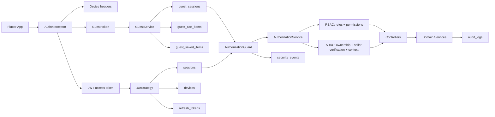
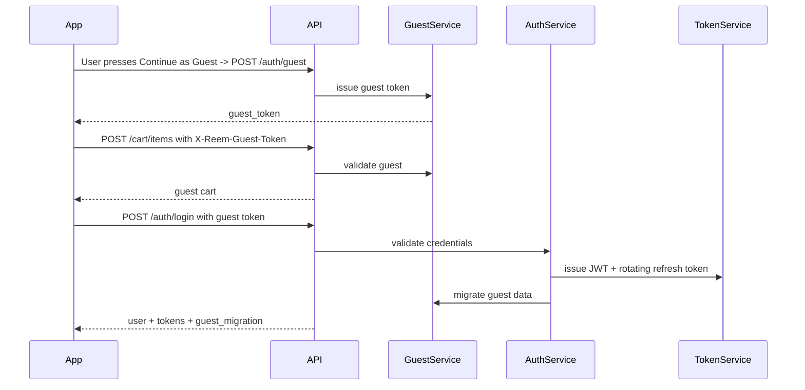

# Ohara Authorization, Authentication, and Identity Architecture

## Core Philosophy

Ohara uses an explicit Guest identity model. A visitor can browse public
surfaces without a server-side identity, and a guest session is created only
after the user presses **Continue as Guest**. Failed login, failed registration,
or session-restore attempts never create guest sessions.

## Architecture Diagram



## Identity States

| State | Token | Stored Data | Allowed |
| --- | --- | --- | --- |
| Guest | `X-Reem-Guest-Token` created by `POST /auth/guest` | guest session, guest cart, guest saves | browse, search, view stores/reviews, temporary save/cart |
| Buyer | JWT access + rotating refresh | user, session, device, cart, favorites | checkout, reviews, comments, messages, synced profile after phone verification |
| Pending Seller | no password login after session loss until approval | seller verification pending/under-review | account/security in active registration session only, no seller operations |
| Verified Seller | JWT | approved verification + `sellerVerifiedAt` + `sellerLevel=VERIFIED` | own products/posts/stories/orders |
| Premium Seller | JWT | `sellerLevel=PREMIUM` and active premium window | future advanced seller tools |
| Admin | JWT | specialized admin role + permissions | only bounded admin functions |

## Database Schema Additions

New enums:

- `SellerLevel`: `BASIC`, `VERIFIED`, `PREMIUM`
- `GuestSessionStatus`: `ACTIVE`, `MIGRATED`, `REVOKED`, `EXPIRED`
- `GuestSavedItemType`: `PRODUCT`, `SELLER`, `POST`
- `SecurityEventType`: guest, login, device, session, authz, seller review events
- `RiskLevel`: `LOW`, `MEDIUM`, `HIGH`, `CRITICAL`

New tables:

- `guest_sessions`: hashed guest token, device/context metadata, expiry, migration state.
- `guest_cart_items`: product/variant/quantity tied to a guest session.
- `guest_saved_items`: temporary saved products, sellers, posts.
- `security_events`: risk-oriented event stream for suspicious behavior and access denial.

User additions:

- `seller_level`
- `seller_verified_at`
- `seller_premium_until`

## Roles And Permissions Matrix

| Role | Scope |
| --- | --- |
| `SUPER_ADMIN` | All permissions, break-glass platform ownership |
| `OPERATIONS_ADMIN` | operations, users, sellers, orders, product operations, analytics |
| `SUPPORT_ADMIN` | support cases, account reads, sessions, seller review, order reads |
| `FINANCE_ADMIN` | finance, payouts, commissions, financial analytics, no content mutation |
| `CONTENT_MODERATOR` | products/posts/stories/reviews/moderation, no finance |
| `SELLER` | seller tools only after verification and only for owned resources |
| `CUSTOMER` | buyer account, checkout, orders, device/session management |
| `ADMIN` / `SUPPORT` | legacy compatibility roles with reduced mappings |

Key permissions include:

- `product:manage`, `post:manage`, `story:manage`
- `seller_verification:submit`, `seller_verification:review`
- `order:read`, `order:manage`, `checkout:create`
- `finance:read`, `finance:write`
- `support:read`, `support:write`
- `content:moderate`
- `analytics:read`, `audit:read`, `authorization:manage`
- `guest_session:create`, `guest_session:migrate`

## Authorization Engine Design

Authorization is centralized in:

- `AuthorizationGuard`
- `AuthorizationService`
- `@Authorize(...)`

The guard supports both old decorators and new policies:

- Legacy: `@Roles(...)`, `@Permissions(...)`
- New: `@Authorize({ action, resource, roles, permissions, allowGuest, requireSellerVerified, sellerLevels, ownership })`

Decision inputs:

- role
- permission set from DB role assignments
- ownership of product/post/story/order/wishlist
- seller verification and seller level
- session state, because `JwtStrategy` rejects revoked/expired sessions
- guest session state when `allowGuest` is declared
- request context for security event logging

## Authentication Flow



## Guest-To-User Migration

Migration runs automatically during login, register, and social sign-in when
`X-Reem-Guest-Token` is present.

Migrated data:

- guest cart items merge into `cart_items`
- guest product saves become `favorites`
- guest seller saves become `seller_favorites`
- guest post saves become `post_favorites`
- the guest session becomes `MIGRATED`
- a `GUEST_MIGRATED` security event is recorded

## Security Design

- Access token is short-lived.
- Refresh tokens are opaque, HMAC-hashed, and rotated on every refresh.
- Refresh token reuse revokes the whole session and records a critical event.
- JWT validation checks the linked `sessions` row on every authenticated request.
- Devices are tracked by privacy-balanced fingerprint hashes and can be trusted or revoked.
- Guest tokens are never stored in plaintext.
- Rate limiting remains global and stricter on sensitive auth endpoints.
- Login attempts, account changes, seller verification, device events, and authz denials are recorded.
- Admin capabilities are separated by permissions, not one generic admin role.

## Frontend Integration

Flutter changes:

- `AuthNotifier.restoreSession()` restores an existing signed-in or explicit guest session but never creates a guest automatically.
- `AuthInterceptor` sends device headers, access token, and an existing guest token.
- login/register/social sign-in preserve the guest token through the request so backend migration can run.
- successful authentication clears the guest session locally.
- router keeps public browsing open and sends protected actions to `AuthRequiredScreen?from=...`.

## Seller Approval Workflow

Seller applications now capture business, contact, legal, financial, shipping,
category, document, website, and social-link metadata. Admin review actions
support `UNDER_REVIEW`, `NEEDS_MORE_DOCUMENTS`, `APPROVED`, `REJECTED`, and
`SUSPENDED`. Every decision stores a reason, reviewer, timestamp, immutable
status-history row, audit log, security event, and seller notification.

Seller operations are protected centrally with `@Authorize({ requireSellerVerified:
true })`, and the authorization engine checks `sellerVerifiedAt` plus
`sellerLevel` instead of the legacy account phone-verification flag.

## Verification

Current verified commands:

```bash
cd backend
npm run build
npm test
```

Known test gap:

- Full `flutter analyze` exceeded five minutes in this workspace; targeted analyzer calls also timed out.
